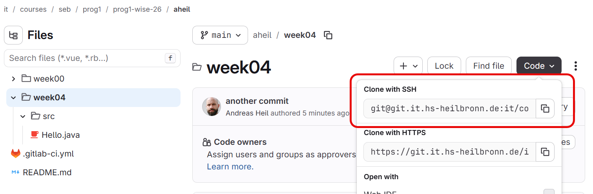

# Exercises

## Week 4: Git and More Language Features

**Tiers:** **C** = core (everyone), **E** = extension (fast students / homework), **X** = challenge (optional).

**Input** is what you type; **Output** is what the program displays.

## How your work is checked (GitLab)

All solutions live in **one GitLab project** (your repository) and are checked automatically.


As part of this course, you have been granted to a GitLab project which represents your repository. Be aware that the HHN GitLab instance is only accessible within the university network or by using a secure connection via EduVPN.


Every time you `git push`, a GitLab pipeline runs one job. A green job means that exercise passes. Open the failed job to see which check failed and why.

Rules for the automatic checks:

* Put your Java files in the folder `week04/src/` of the repository, in the default package (no `package` line).
* The class and file names must match the name given in the exercise exactly, for example `Week04Ex22` in `src/Week04Ex22.java`.
* Use the exact output text from the exercise. Do not print extra text unless the exercise asks for it.
* Commit and push your solution. Only committed and pushed work is checked.


Before you start, you have to create and upload a SSH key pair to be used with GitLab. How to create and setup this is described here: [https://docs.gitlab.com/user/ssh/](https://docs.gitlab.com/user/ssh/) - follow this documentation carefully and keep your private part of the kay pair securley stored.&#x20;


***

### Session 1: Git introduction

Time plan: 0-5 min why Git, 5-35 min guided practice at the terminal, 35-42 min quiz, 42-45 min wrap-up.

**Prerequisites:** Git is installed (`git --version`) and you can log in to GitLab.


If Git is not installed on your machine yet, please follow the steps for your operating system at [https://git-scm.com/install/](https://git-scm.com/install/).


| Exercise                    | Check in GitLab                                                                                                                                     |
| --------------------------- | --------------------------------------------------------------------------------------------------------------------------------------------------- |
| Ex 1.1, 1.2, 1.6, 1.9, 1.10 | A running pipeline proves 1.2 (clone and push work); 1.1, 1.6, 1.9 are checked by your tutor; 1.10 is covered by the commit-message check of Ex 1.7 |
| Ex 1.3                      | job `1_3`                                                                                                                                           |
| Ex 1.4                      | job `1_4`                                                                                                                                           |
| Ex 1.5                      | job `1_5`                                                                                                                                           |
| Ex 1.7                      | job `1_7`                                                                                                                                           |
| Ex 1.8                      | job `1_8`                                                                                                                                           |

#### Cloning your repository&#x20;

Before you can work with your code on your machine, you have to clone repository. To do so, log into GitLab using the link provided before. <br>

Use the _Code_ button and copy the URL from _Clone with SSH._

<figure><figcaption></figcaption></figure>

Navigate to a folder where you want to clone (create a local copy) the repository and use


```
git clone <theURLfromBefore>
```


This will create a folder with you user name with the folder you are currently in. Change to this folder and configure your Git repository as in Ex 1.1.

#### Ex 1.1 (C): Configure Git

Set your name, e-mail, and default branch as shown in the handout. Check with `git config --list`.

#### Ex 1.2 (C): Clone your project

Your tutor creates a GitLab project for you. Clone it with `git clone <url>`, change into the folder, and run `git status`. Create the folder `week04` and navigate to this folder. Now create the folder  `src` within.

#### Ex 1.3 (C): First commit

Create `src/Hello.java` with the class `Hello`. It prints `Hello, Git!`. Run `git status`, stage the file with `git add`, run `git status` again, and commit it with a good message. Check with `git log --oneline`, then `git push`.

**Check:** `src/Hello.java` is committed; the first output line is `Hello, Git!`.

#### Checkpoint: How to use the pipeline

Before you proceed, check if the pipeline finished sucesfully.&#x20;

Open your browser and navigate to your repository in GitLab. If not done yet, it is time to bookmark it in your browser.

#### Ex 1.4 (C): Second commit

Change `Hello` so that it prints a second line, `I am learning version control.` Run `git diff` and read the output. Stage, commit, and push.

**Check:** the output is exactly `Hello, Git!` and `I am learning version control.`; `Hello.java` appears in at least two commits.\
\
On the left sidebar navigate to _Build / Pipelines:_

<figure><figcaption></figcaption></figure>

From the list choose the topmost one (which should be indicated as failed).

<figure><figcaption></figcaption></figure>

You now will get a detailed view of he pipeline. Click on on the failed job. This will show you the console output of your pipeline. Scoll through the output and try to find the error message related to your exercise.&#x20;

<figure><figcaption></figcaption></figure>

The pipeline will provide a detailed overview of your run. You can access it on the r ight side using the _Browse_ button.

<figure><figcaption></figcaption></figure>

Navigate to _reports / week04_ and open or download the _report.md_ file.

This file will show you a overview of your current exercises:&#x20;

<figure><figcaption></figcaption></figure>

Now contionue with the exercises.

#### Ex 1.5 (C): Ignore compiled files

Compile your program so that `Hello.class` appears. Check that `git status` lists it. Create `.gitignore` with the lines `*.class` and `out/`, check again that the class file is gone from `git status`, commit `.gitignore`, and push. If you committed a `.class` file by mistake, remove it with `git rm --cached <file>`.

**Check:** `.gitignore` is committed and contains `*.class`; no `.class` file is tracked.

#### Ex 1.6 (C): Undo a change

Break `Hello.java` on purpose (delete a semicolon). Check `git status` and `git diff`, then restore the file with `git restore`. Compile it to prove it works again.

**Check (tutor):** show the output of `git status` before and after.

#### Ex 1.7 (C): Meaningful commit messages

Look at your history with `git log --oneline`. Every message must describe the change (`Add Hello program`, not `fix` or `stuff`). Your repository needs at least 5 commits by the end of the session. Use Ex 1.8 to get there.

**Check:** at least 5 commits; every message has at least 10 characters and more than one word; vague messages such as `fix`, `update`, or `stuff` fail.

#### Ex 1.8 (C): Several files, several commits

Create two programs, each in its own file and **its own commit**:

* `src/Square.java` (class `Square`): read an integer and print its square. `7` gives `49`, `-3` gives `9`.
* `src/Max.java` (class `Max`): read two integers (one per line) and print the larger one. `3` and `9` give `9`.

Push both commits.

**Check:** both programs produce the correct output; `Square.java` and `Max.java` were added in different commits.

#### Ex 1.9 (E): Clone and pull

Clone your repository into a second folder. In the first folder, make a commit and push. In the second folder, run `git pull` and check that the new commit arrives.

#### Ex 1.10 (X): Fix a bad commit message

Make a commit with the message `stuff`. Fix it with `git commit --amend` before pushing. Explain why you should not amend a commit that is already pushed. The pipeline of Ex 1.7 fails if the bad message reaches GitLab.

***

### Session 2: `do-while`, `break`, `continue`, `switch`

Time plan: 0-5 min recap, 5-32 min exercises, 32-42 min quiz, 42-45 min wrap-up.

Commit and push every finished exercise separately, with a message such as `Add Week04Ex22 validated input`. The job `session2: [2_N]` checks Ex 2.N.

| Exercise | File                   | Job    |
| -------- | ---------------------- | ------ |
| Ex 2.1   | `src/Week04Ex21.java`  | `2_1`  |
| Ex 2.2   | `src/Week04Ex22.java`  | `2_2`  |
| Ex 2.3   | `src/Week04Ex23.java`  | `2_3`  |
| Ex 2.4   | `src/Week04Ex24.java`  | `2_4`  |
| Ex 2.5   | `src/Week04Ex25.java`  | `2_5`  |
| Ex 2.6   | `src/Week04Ex26.java`  | `2_6`  |
| Ex 2.7   | `src/Week04Ex27.java`  | `2_7`  |
| Ex 2.8   | `src/SwitchBug.java`   | `2_8`  |
| Ex 2.9   | `src/Week04Ex29.java`  | `2_9`  |
| Ex 2.10  | `src/Week04Ex210.java` | `2_10` |
| Ex 2.11  | `src/Week04Ex211.java` | `2_11` |
| Ex 2.12  | `src/Week04Ex212.java` | `2_12` |

#### Ex 2.1 (C): Countdown with `do-while`

Read a whole number `start`. Print the numbers from `start` down to `1`, one per line, using a `do-while` loop. Because the body runs first, a start of `0` or less prints just the start value once.

| Input | Output        |
| ----- | ------------- |
| `3`   | `3`, `2`, `1` |
| `0`   | `0`           |
| `-4`  | `-4`          |

Then think about what a `while` loop would print for `0`.

#### Ex 2.2 (C): Validated input

Ask for a number from 1 to 10 with the prompt `Enter a number (1-10):` (use `System.out.print`). Repeat the prompt until the input is valid. Then print `You chose N`.

Input `0`, `11`, `-5`, `7` shows the prompt four times and then ends with `You chose 7`.

#### Ex 2.3 (C): Menu loop

Print the menu `1) Say hello`, `2) Say goodbye`, `0) Exit` (three lines) before each choice. Read a choice and print `Hello!`, `Goodbye!`, or `Invalid choice`. Repeat until the user chooses `0`.

Input `1`, `2`, `5`, `0` prints the menu four times and the replies `Hello!`, `Goodbye!`, `Invalid choice`.

#### Ex 2.4 (C): Digit count

Read a whole number and print how many digits it has. Use a `do-while` loop and divide by 10 until the number is 0. Test `7` (1), `1000` (4), and `0` (1, which is why `do-while` fits).

#### Ex 2.5 (C): First multiple

Read a number `k`. Use `break` to print the first number from 1 to 1000 that is divisible by both `k` and 7. If there is none, print `None`. For `k = 3` the result is `21`; for `k = 143` it is `None`.

#### Ex 2.6 (C): Skip with `continue`

Print the numbers `1` to `20`, one per line, but skip multiples of 3 and multiples of 5. Expected start: `1`, `2`, `4`, `7`, `8`, `11`.

#### Ex 2.7 (C): Weekday with `switch`

Read a number from 1 to 7 and print the weekday name (`Monday` ... `Sunday`). For Saturday and Sunday, print the name and then a second line `Weekend` (use `case 6:` and `case 7:`). Print `Invalid day` for other values.

#### Ex 2.8 (C): Fix the bugs

Find and fix three mistakes. Save the fixed class as `src/SwitchBug.java`. For input `2` the program must print `Two` and nothing else; for `9` it prints `Other`.

```java
import java.util.Scanner;

public class SwitchBug {
    public static void main(String[] args) {
        Scanner in = new Scanner(System.in);
        int n = in.nextInt();
        switch (n) {
            case 1:
                System.out.println("One");
            case 2:
                System.out.println("Two");
            case 3:
                System.out.println("Three");
            default
                System.out.println("Other");
        }
    }
}
```

#### Ex 2.9 (E): Calculator

Per round, read two whole numbers and an operator (`+`, `-`, `*`, `/`), each on its own line. Use `switch` on the `char` (read it with `in.next().charAt(0)`) to print the result; `/` is integer division. Print `Division by zero` for `/` with a second number of `0`, and `Unknown operator` for any other character. After each round print `Again? (y/n)` and read the answer; repeat while it is `y` (use `do-while`).

Input `6`, `3`, `+`, `n` prints `9` and `Again? (y/n)`.

#### Ex 2.10 (E): Guess the number

The first input is the secret number (an imaginary second player entered it). Then read guesses with a `do-while` loop. After a wrong guess print `Higher` if the secret is higher than the guess, otherwise `Lower`. At the end print `Correct after N guesses` (always `guesses`, even for 1).

Input `42`, `50`, `30`, `42` prints `Lower`, `Higher`, `Correct after 3 guesses`.

#### Ex 2.11 (E): Compound operators

Read `x`. Apply `x += 5;`, `x *= 2;`, `x -= 1;`, `x %= 4;` in this order, printing `x` after each statement (one per line). For `10`: `15`, `30`, `29`, `1`.

#### Ex 2.12 (X): Collatz

Read a positive number. Repeat: if it is even, halve it, otherwise compute `3n + 1`. Print the first line with all values, separated by spaces, until you reach `1`. Print a second line `Steps: N`. For `6`:

```
6 3 10 5 16 8 4 2 1
Steps: 8
```

***

### Homework

The homework is checked by the jobs `HW1` and `HW2`.

1. **Number guessing game (job `HW1`, `src/GuessingGame.java`).** Based on Ex 2.10: the first input is the secret number. Guesses outside 1-100 print `Invalid guess` and do not count (use `do-while` for the input check). The player has at most 7 valid guesses. Print `Higher` or `Lower` after a wrong guess, `Correct after N guesses` for a win, and `You lose, the number was N` after the 7th wrong guess.
2. **Repository with history (job `HW2`).** Your repository contains at least **5 commits** with meaningful messages, a `.gitignore` for `*.class`, no `.class` files, and the programs `Week04Ex22`, `Week04Ex23`, `Week04Ex27`, and `GuessingGame` in `src/`.

**Acceptance criteria:** all jobs of the pipeline are green; programs compile and run; input is validated; the repository contains no `.class` files; commit messages describe the change.
